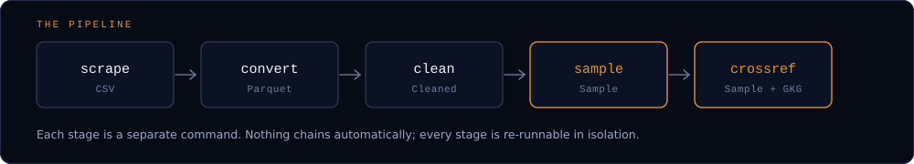

# Getting Started

## Installation

GdeltForge needs Python 3.10 or later.

=== "pip"

    ```bash
    pip install gdeltforge
    ```

=== "uv"

    ```bash
    uv pip install gdeltforge
    ```

Verify it installed:

```bash
gdeltforge --help
```

### Installing from source

??? note "Only needed if you're contributing to GdeltForge itself, or want an editable install"

    ```bash
    # Install uv (if not already installed)
    pip install uv

    git clone https://github.com/Vinicius-Teixeirac/GdeltForge.git
    cd GdeltForge

    # Create the virtual environment, install dependencies, and install
    # GdeltForge itself (editable): this is what makes the `gdeltforge`
    # command available.
    uv sync

    # Activate the virtual environment
    # Windows
    .venv\Scripts\activate
    # macOS / Linux
    source .venv/bin/activate

    # Verify the CLI is installed
    gdeltforge --help
    ```

`python main.py <command>` also works as a backward-compatible alias for the `gdeltforge` command, in case you have existing scripts built around it. This alias is only present in a source checkout, not in the PyPI package.

## Configuration

!!! tip "Optional: skip this and everything below still runs"

    GdeltForge falls back to a conservative built-in default (real `./data/...` paths, no row/column filtering) if there's no config file, and writes that default to `config/settings.yaml` on first run. A fresh environment (a Colab session, say) works with nothing configured.

Worth doing anyway for a real project, so you're deciding `paths:` and the `clean:` settings deliberately rather than accepting the defaults:

```bash
cp config/settings.example.yaml config/settings.yaml
```

At minimum, review `paths:` (where downloaded, converted and cleaned data will live) and `clean:` (which repairs and corrections the clean stage applies; see [below](#optional-corrections)). See the full [Configuration](configuration.md) reference for every option, including what the built-in fallback actually sets.

If the data sits on network storage (NFS, SMB) or a disk shared with other users, also set `io.max_concurrent_reads`: the defaults allow one read per core, and a shared server saturates at a handful. [Network storage](configuration.md#network-storage-nfs-smb-shared-hdd-arrays) gives a measured starting point.

## Your first pipeline run



Each stage is a separate command, run in order. A small, date-restricted run is the fastest way to confirm everything is wired up correctly:

```bash
gdeltforge scrape --dataset events --start-date 2024-01-01 --end-date 2024-01-07
gdeltforge convert --dataset events
gdeltforge clean --dataset events
gdeltforge sample --dataset events --mode indexed -n 1000 --out sample.parquet
```

This downloads one week of daily GDELT files, converts them to Parquet, cleans them, and writes a 1,000-row random sample to `sample.parquet`.

With the built-in defaults, `clean` keeps every row and never loses one of GDELT's values. It repairs the events GDELT dated 1920 instead of 2020, keeping GDELT's own dates in `*_original` columns, and counts the rows whose event code isn't a CAMEO category. It drops rows only for the columns you list under `clean.columns_to_check`. Every file it writes is marked as cleaned, naming its source file, and every run writes an audit, one row per file, to a directory next to the cleaned one (`data/events/cleaned_runs/` by default): rows in and out, what each step changed, and codes missing from the code tables. `gdeltforge clean --dry-run --report` measures all of that without writing anything. See [Data Cleaning](data-cleaning.md) for every step.

Once that works, drop the date flags to work with the full archive (1979-present).

!!! warning "The full archive is big"

    Dropping the date flags means thousands of files and hundreds of GB. Try `--dry-run` first to see how many files a scrape would pull, and see [Capacity planning](configuration.md#capacity-planning-real-measured-numbers) for measured sizes per dataset.

### Optional corrections

Three more `clean` steps correct GDELT's values, each off by default because it replaces them without keeping the originals. Turn them on per dataset in `config/settings.yaml`:

```yaml
clean:
  places:
    gdelt_event:
      resolve: true        # one place per geo point
  normalize:
    gdelt_event:
      trim_strings: true   # " USA" becomes "USA"
      blank_to_null: true  # " " becomes null
  derive:
    gdelt_event:
      event_date: true     # adds EventDate, a real date
```

- **[Places](data-cleaning.md#places-one-place-per-geo-point)** resolves each event's three geo points to one place per point, from a table built once from the full archive and bundled with GdeltForge. GDELT writes the same place under several IDs (the United States as `US` and as `0`), one ID for two places, countries at another country's point, and region names its encoding damaged; the step gives each point one ID, one point and one name, and the run audit counts each correction by the GDELT defect it fixes.
- **[Normalize](data-cleaning.md#normalize-whitespace)** removes the whitespace GDELT padded about 15 million 2013 values with, so `" USA"` matches `"USA"`.
- **[Derive](data-cleaning.md#derive-added-columns)** adds columns and never replaces one: `EventDate`, and a name column for any CAMEO-coded column you list.

### Reproducible draws

`--seed` (default 42) makes every sample reproducible. Beyond simple random sampling, `--mode calendar` draws a fixed number of rows per day, month or year, and `--mode filtered` samples the rows a JSON filter selects, optionally stratified by a column. Calendar and stratified samples write each stratum's true size next to the sample, for reweighting. [Sampling Theory](sampling-theory.md) gives the design behind each mode.

`--provenance` adds two columns to every sampled row, `SourceFile` and `SourceRow`: the converted file it comes from and its position there. Those two identify a row exactly, so the same rows can be read again from data cleaned with other settings and compared row for row:

```bash
gdeltforge sample --dataset events --mode calendar --period month --per-period 100 --provenance --out draw.parquet
```

### The 15-minute datasets

GKG 2.1, Mentions and `events-15min` arrive as 96 files a day. `gdeltforge aggregate --dataset gkg-v2 --period day` concatenates a period's files into one, after `clean`, and `sample`/`crossref --source aggregated` read the result: on a network share, indexing a GKG 2.1 archive for sampling went from 9,027 s to 50 s. See [Aggregation](configuration.md#aggregation).

## Running the test suite

The test suite is pure unit tests: no network access, no browser, no real GDELT data required.

```bash
uv sync --group dev
uv run pytest
```

## Building the docs locally

This site is built with [MkDocs](https://www.mkdocs.org/) + the [Material theme](https://squidfunk.github.io/mkdocs-material/).

```bash
uv sync --group docs
uv run mkdocs serve
```

Then open `http://127.0.0.1:8000/`.

## Where to go next

<div class="gf-grid gf-grid--3">
  <a class="gf-card gf-card--link" href="../data-cleaning/"><h3>Data Cleaning →</h3><p>What <code>clean</code> repairs and corrects, and why.</p></a>
  <a class="gf-card gf-card--link" href="../cli-reference/"><h3>CLI Reference →</h3><p>Every command, every flag, with examples.</p></a>
  <a class="gf-card gf-card--link" href="../recipes/"><h3>Recipes →</h3><p>Runnable, end-to-end workflows.</p></a>
  <a class="gf-card gf-card--link" href="../sampling-theory/"><h3>Sampling Theory →</h3><p>The design behind each sampling mode.</p></a>
  <a class="gf-card gf-card--link" href="../configuration/"><h3>Configuration →</h3><p>The full <code>settings.yaml</code> reference.</p></a>
  <a class="gf-card gf-card--link" href="../crossref-join-semantics/"><h3>Crossref Semantics →</h3><p>What the Events<->GKG join really produces.</p></a>
</div>
