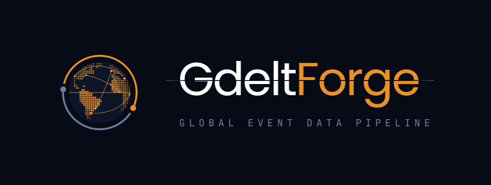
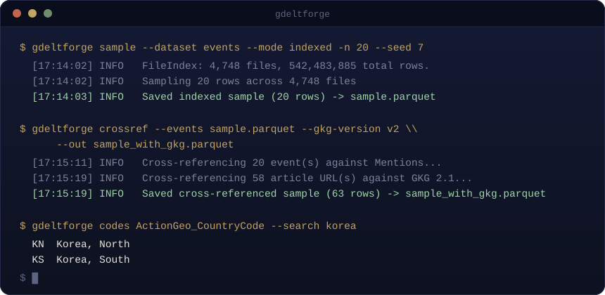
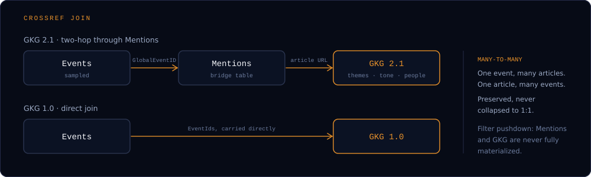

<div class="gf-hero">
  <div class="gf-hero__grid">
    <div>
      
      <p>Reproducible sampling and cross-referencing of the full GDELT archive, on one machine.</p>
      <div class="gf-install"><span class="gf-prompt">$</span> pip install gdeltforge</div>
    </div>
    
  </div>
</div>

GDELT publishes its full archive (Events since 1979, GKG 1.0 since 2013, GKG 2.1 and Mentions since 2015) as hundreds of thousands of raw files. Drawing a sample from it that another researcher can reproduce, and whose relation to the archive is known, is harder than it should be. GDELT's search APIs answer bounded queries: the DOC API, for instance, returns up to 250 articles from the last three months. BigQuery's public dataset holds the whole history, within a free tier of 1 TiB of queries a month, but its tables stay in Google's warehouse, not on your own disk.

GdeltForge is a command-line pipeline that downloads that archive, converts it to Parquet, repairs GDELT's documented errors, and draws seeded samples whose design (simple random, stratified by period or by column) is stated explicitly. It runs on a single machine, over an archive far larger than its memory. It was written for research on representation learning over GDELT events; [About](about.md) gives the background and the decisions that came from it.

<div class="gf-section">
  <p class="gf-eyebrow">The pipeline <span>Five stages, each a separate command you can rerun on its own.</span></p>
  <div class="gf-grid gf-grid--5">
    <div class="gf-card"><h3>scrape</h3><p>Downloads the raw archive, checking each file against the checksum GDELT publishes.</p><span class="gf-card__io">→ CSV</span></div>
    <div class="gf-card"><h3>convert</h3><p>Converts CSV to Parquet, a format change only: the archive as GDELT published it.</p><span class="gf-card__io">→ Parquet</span></div>
    <div class="gf-card"><h3>clean</h3><p>Repairs errors GDELT itself documents, keeping its values and every row by default. Marks every file and audits every run.</p><span class="gf-card__io">→ Cleaned</span></div>
    <div class="gf-card"><h3>sample</h3><p>Draws a seeded sample with a stated design, streaming over the archive.</p><span class="gf-card__io">→ Sample</span></div>
    <div class="gf-card"><h3>crossref</h3><p>Joins a sample of Events to GKG, keeping the many-to-many structure.</p><span class="gf-card__io">→ Sample + GKG</span></div>
  </div>
</div>

## What it does

- Downloads the full archive: Events since 1979, GKG 1.0 since 2013, GKG 2.1 and Mentions since 2015, seven datasets in all.
- Stores it as Parquet twice over: as published (`convert`), and repaired (`clean`), in separate directories. `--source` picks which one a sample reads.
- Repairs documented GDELT errors, keeping every row by default; audits every run.
- Seeded sampling: simple random (`indexed`), by period (`calendar`), filtered, and stratified. Stratified and calendar samples write each stratum's true size next to the sample, for reweighting.
- Joins sampled Events to GKG, keeping the many-to-many structure between events and articles.
- Looks up CAMEO and FIPS codes offline (`gdeltforge codes`).

## Sampling designs

| Mode | Design | Representative of the archive? |
|---|---|---|
| `indexed` | Simple random sample without replacement | Yes, up to sampling variance |
| `calendar` | Stratified by day, month or year, equal allocation (`--per-period` rows each) | Only after reweighting each period by its true size |
| `filtered` | Simple random sample of the rows matching a filter | Of the filtered rows |
| `filtered --stratify` | Stratified by a column, equal allocation | Only after reweighting |

Every mode is seeded: the same command over the same files draws the same rows. [Sampling Theory](sampling-theory.md) names the algorithm behind each mode, with its sources, and [Representativeness](limitations-and-roadmap.md#representativeness) explains what each design means for estimates drawn from it.

## Crossref

GKG 2.1 carries no event identifier, only the URL of the article it describes, so joining it to Events goes through Mentions. `crossref` performs that join and keeps every (event, article, GKG record) combination, since one event is reported by many articles and one article reports many events. [Crossref Join Semantics](crossref-join-semantics.md) covers the details.



## Quickstart

One week of data, end to end. No config file is needed: GdeltForge writes a conservative default on first run.

```bash
pip install gdeltforge

gdeltforge scrape  --dataset events --start-date 2024-01-01 --end-date 2024-01-07
gdeltforge convert --dataset events
gdeltforge clean   --dataset events
gdeltforge sample  --dataset events --mode indexed -n 1000 --out sample.parquet
```

[Getting Started](getting-started.md) walks through it; [Related Work](comparison.md) describes other ways to work with GDELT and when each fits better.

## Citing

If GdeltForge contributes to published work, please cite it (the repository's `CITATION.cff` has the details) and the GDELT Project, whose data it processes. See [About](about.md#citing).

<p class="gf-attrib">GdeltForge processes data published by <a href="https://www.gdeltproject.org/">the GDELT Project</a>, which makes it available for unlimited and unrestricted use, provided any use or redistribution includes a citation and a link to their site. GdeltForge itself is an independent, unofficial tool, not affiliated with, endorsed by, or sponsored by the GDELT Project.</p>
